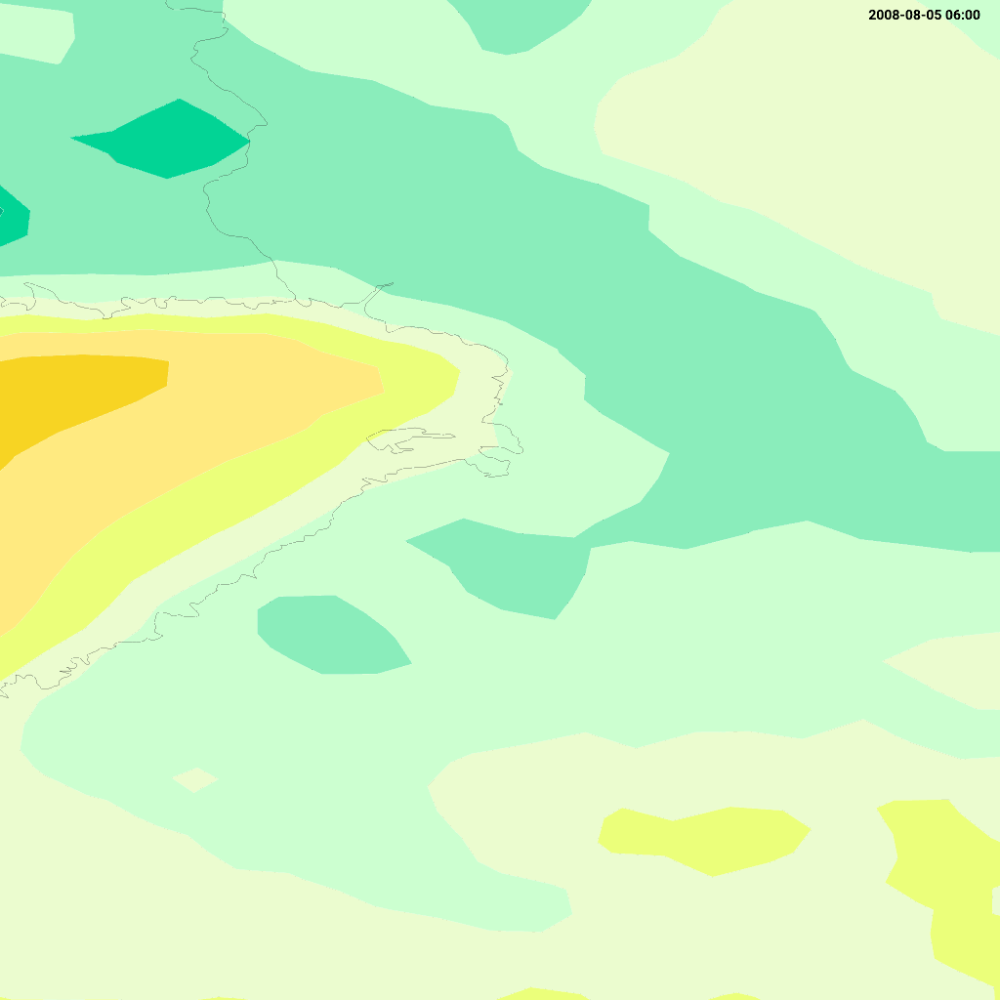
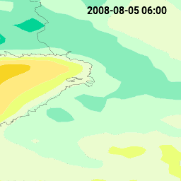
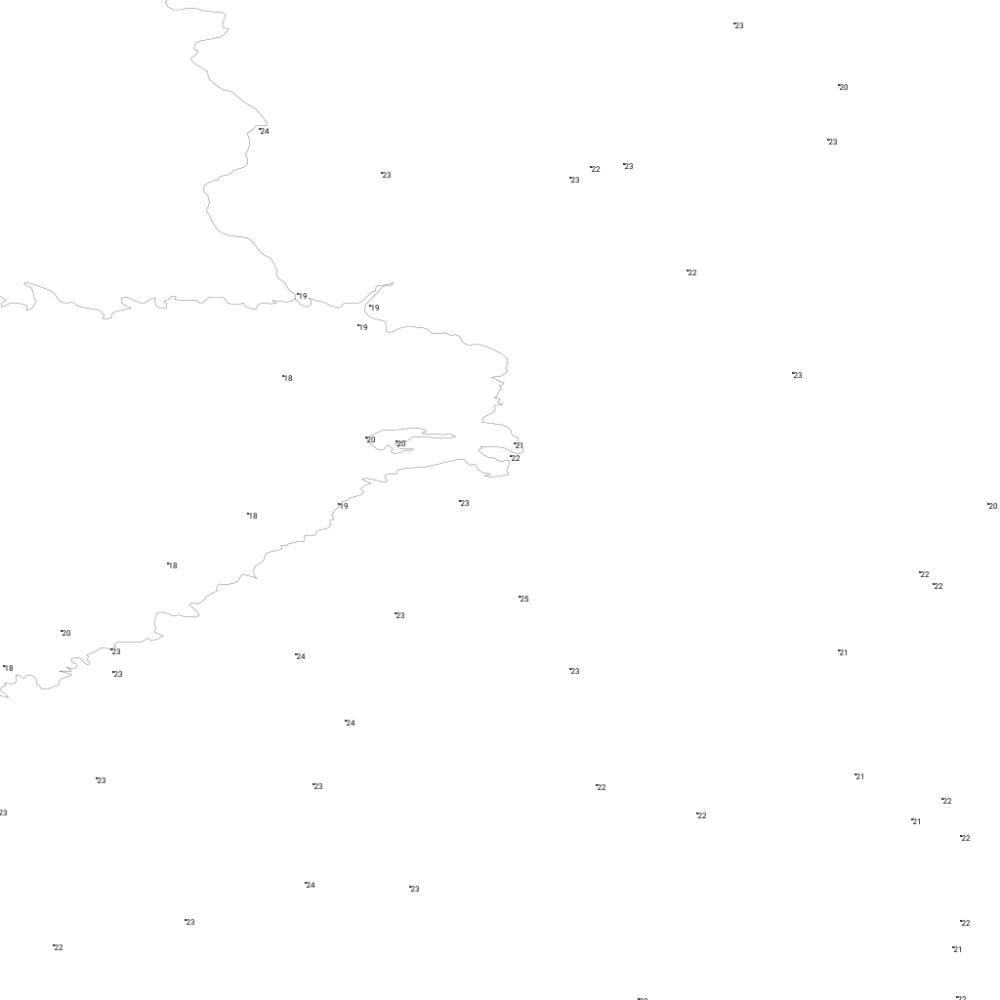
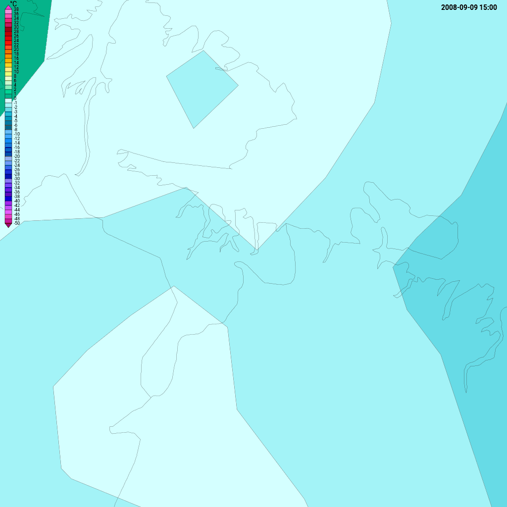
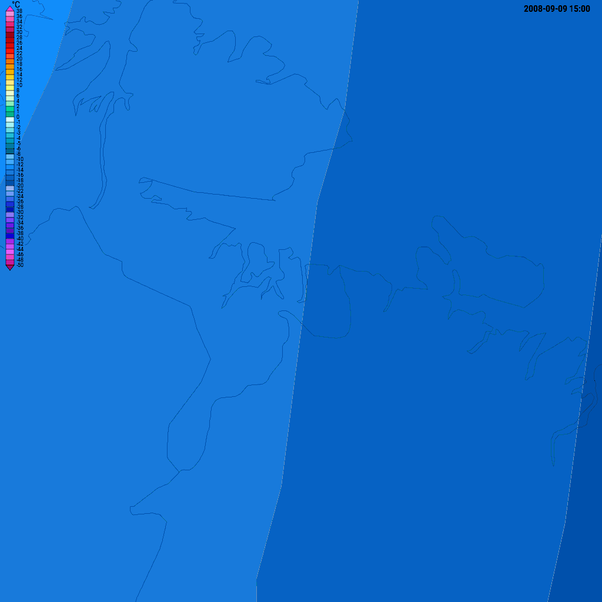
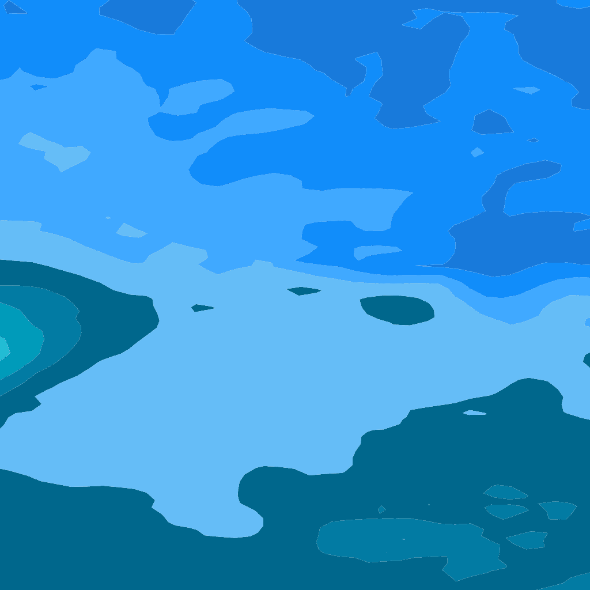
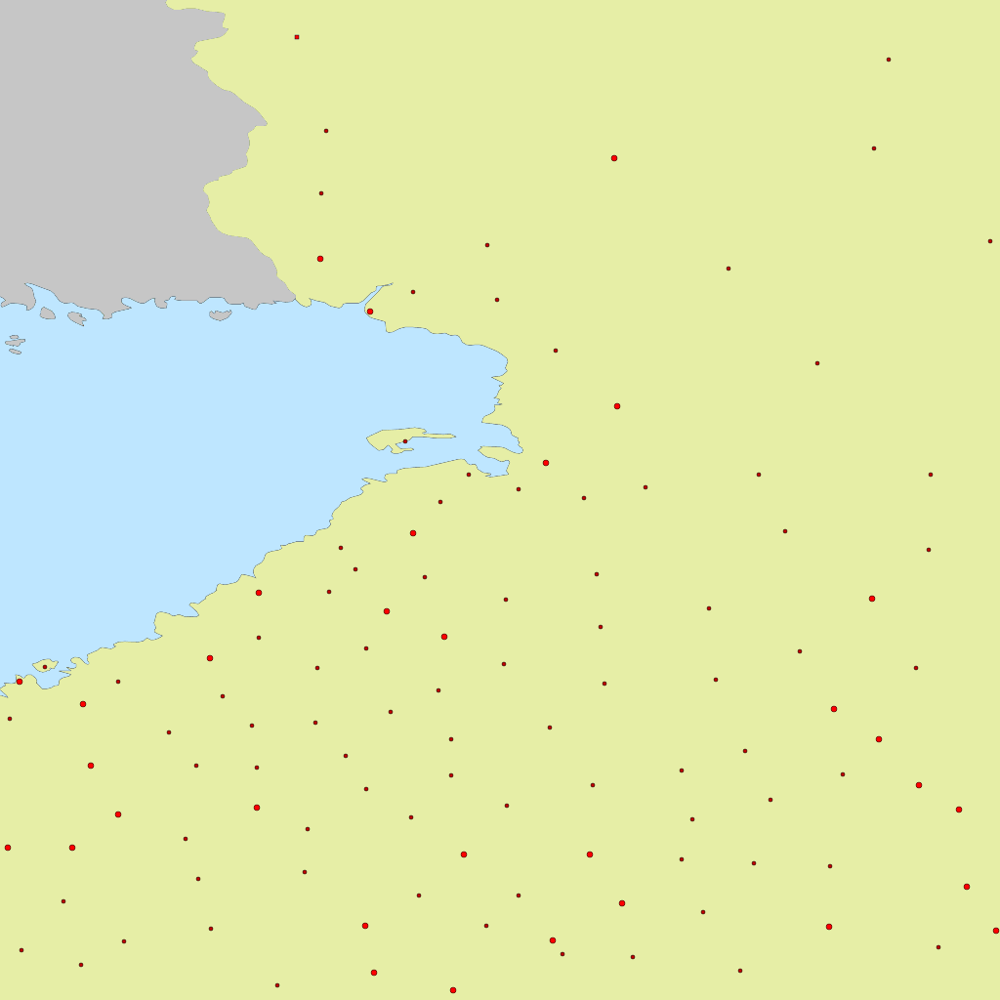
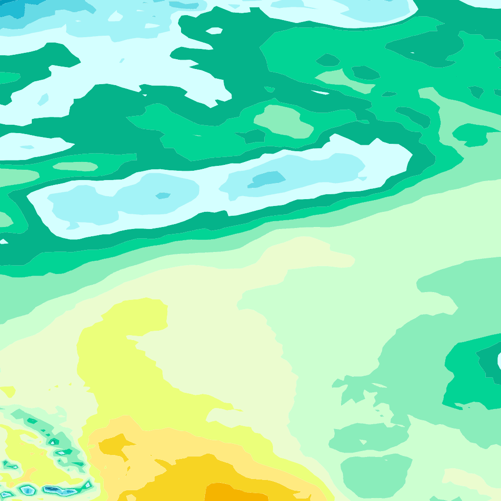
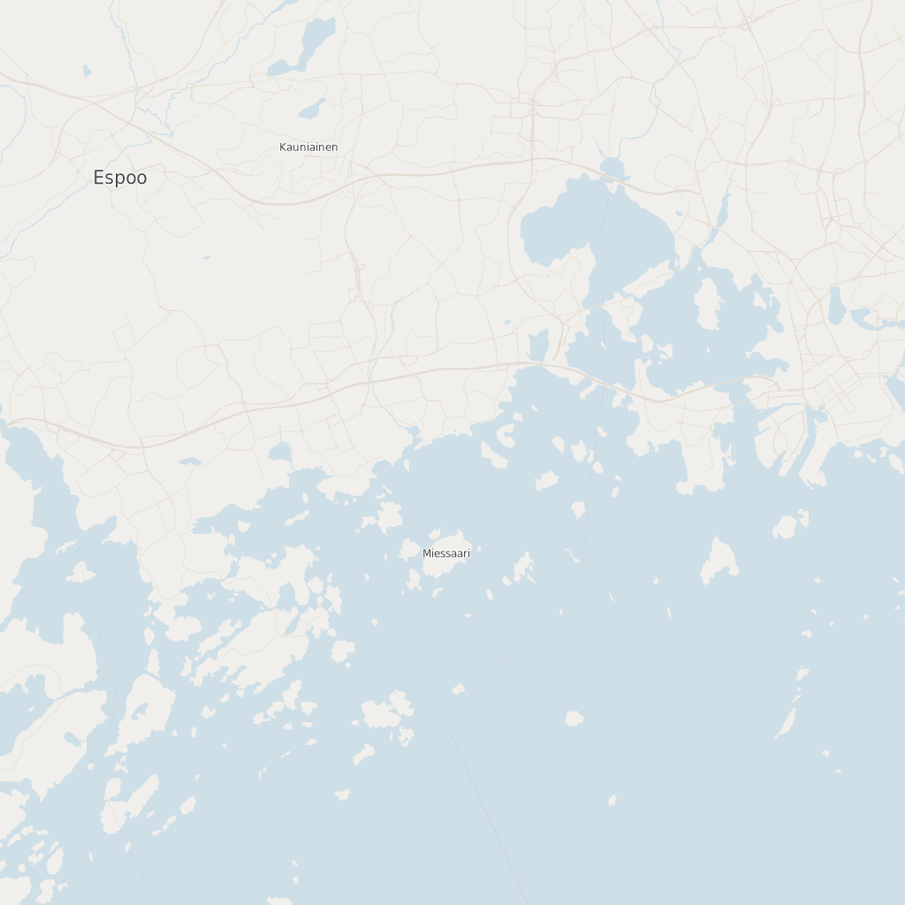
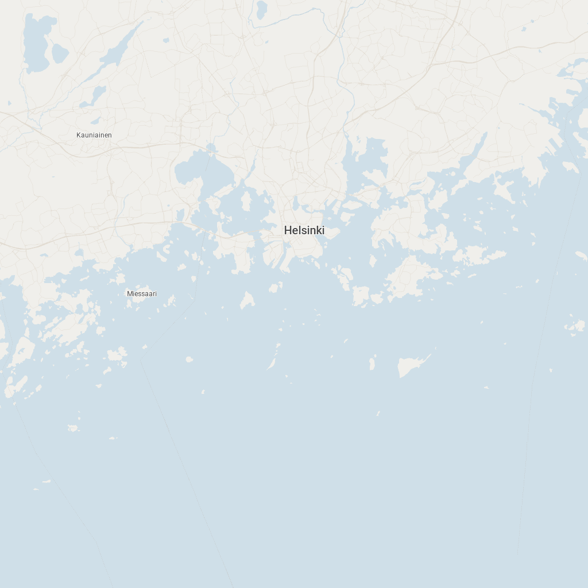

# OGC Tiles Test Examples

The OGC Tiles tests exercise the `/tiles` endpoint, which implements the OGC API — Tiles standard.  This is the RESTful successor to WMTS using the collections model.  The URL path structure is:

```
/tiles/collections/{collection}/tiles/{TileMatrixSet}/{TileMatrix}/{TileRow}/{TileCol}?f={format}[&datetime=…][&elevation=…][&reference_time=…]
```

Unlike WMTS (which carries dimensions as path segments), OGC API — Tiles passes them as **query parameters** (see [Dimensions](#dimensions) below).

Test inputs are in [`test/input/tiles_*.get`](../../test/input/) and expected outputs in [`test/output/tiles_*.get`](../../test/output/).

## Contents

- [URL Structure](#url-structure)
  - [Dimensions](#dimensions)
- [Landing Page, Conformance and API](#landing-page-conformance-and-api)
  - [Landing Page](#landing-page)
    - <sub>[tiles_landing](#tiles_landing) · [tiles_landing_host_injection](#tiles_landing_host_injection)</sub>
  - [Conformance](#conformance)
    - <sub>[tiles_conformance](#tiles_conformance)</sub>
  - [OpenAPI Definition](#openapi-definition)
    - <sub>[tiles_api](#tiles_api) · [tiles_api_html](#tiles_api_html) · [tiles_api_docs](#tiles_api_docs) · [tiles_api_docs_asset](#tiles_api_docs_asset)</sub>
  - [API Catalog](#api-catalog)
    - <sub>[tiles_api_catalog](#tiles_api_catalog)</sub>
- [Collections](#collections)
  - [Collection Listing](#collection-listing)
    - <sub>[tiles_getcollections](#tiles_getcollections)</sub>
  - [Collection Metadata](#collection-metadata)
    - <sub>[tiles_getcollection_pressure](#tiles_getcollection_pressure) · [tiles_getcollection_interval_time](#tiles_getcollection_interval_time)</sub>
- [Tiles](#tiles)
  - [Rendered Tiles](#rendered-tiles)
    - <sub>[tiles_gettile_isoband](#tiles_gettile_isoband) · [tiles_gettile_isoband_resized](#tiles_gettile_isoband_resized) · [tiles_gettile_temperature_numbers](#tiles_gettile_temperature_numbers)</sub>
  - [GeoTIFF Data Tiles](#geotiff-data-tiles)
    - <sub>[tiles_gettile_geotiff](#tiles_gettile_geotiff) · [tiles_gettile_geotiff_wind_speed_and_direction_1 and _2](#tiles_gettile_geotiff_wind_speed_and_direction_1-and-_2) · [tiles_gettile_geotiff_querydata and _epsg3067](#tiles_gettile_geotiff_querydata-and-_epsg3067)</sub>
  - [DataTile Output](#datatile-output)
    - <sub>[tiles_gettile_datatile_wind](#tiles_gettile_datatile_wind)</sub>
  - [Mapbox Vector Tiles](#mapbox-vector-tiles)
    - <sub>[tiles_gettile_mvt_isoband](#tiles_gettile_mvt_isoband) · [tiles_gettile_mvt_isoline](#tiles_gettile_mvt_isoline) · [tiles_gettile_mvt_numbers](#tiles_gettile_mvt_numbers) · [tiles_gettile_mvt_circles](#tiles_gettile_mvt_circles)</sub>
  - [Elevation Dimension](#elevation-dimension)
    - <sub>[tiles_gettile_elevation_850 / _500](#tiles_gettile_elevation_850--_500)</sub>
  - [Product Variants](#product-variants)
    - <sub>[tiles_gettile_variant_ground](#tiles_gettile_variant_ground)</sub>
  - [Resource Resolution](#resource-resolution)
    - <sub>[tiles_gettile_wms_root_css](#tiles_gettile_wms_root_css)</sub>
  - [Gridded Observations](#gridded-observations)
    - <sub>[tiles_gettile_obsgrid](#tiles_gettile_obsgrid) · [tiles_gettile_geotiff_obsgrid](#tiles_gettile_geotiff_obsgrid) · [tiles_gettile_geotiff_obsgrid_humidity](#tiles_gettile_geotiff_obsgrid_humidity)</sub>
- [OpenStreetMap Tiles and Styles](#openstreetmap-tiles-and-styles)
  - [OSM Raster Tiles](#osm-raster-tiles)
    - <sub>[tiles_osm_png / tiles_osm_png_etrs_tm35fin](#tiles_osm_png--tiles_osm_png_etrs_tm35fin)</sub>
  - [OSM Vector Tiles](#osm-vector-tiles)
    - <sub>[tiles_osm_mvt / tiles_osm_mvt_overzoom / tiles_osm_mvt_outside](#tiles_osm_mvt--tiles_osm_mvt_overzoom--tiles_osm_mvt_outside)</sub>
  - [OSM Style](#osm-style)
    - <sub>[tiles_osm_style](#tiles_osm_style)</sub>
- [Styles](#styles)
  - [Style Listings](#style-listings)
    - <sub>[tiles_getstyles](#tiles_getstyles) · [tiles_getcollectionstyles](#tiles_getcollectionstyles)</sub>
  - [Mapbox GL Styles](#mapbox-gl-styles)
    - <sub>[tiles_getstyle_isoband](#tiles_getstyle_isoband) · [tiles_getstyle_multilayer](#tiles_getstyle_multilayer) · [tiles_getstyle_named](#tiles_getstyle_named)</sub>
  - [Style Errors](#style-errors)
    - <sub>[tiles_getstyle_unknown_collection](#tiles_getstyle_unknown_collection) · [tiles_getstyle_unknown_style](#tiles_getstyle_unknown_style)</sub>
- [Feature Info](#feature-info)
  - [Response Formats](#response-formats)
    - <sub>[tiles_getfeatureinfo_json](#tiles_getfeatureinfo_json) · [tiles_getfeatureinfo_html](#tiles_getfeatureinfo_html)</sub>
  - [Feature Info Errors](#feature-info-errors)
    - <sub>[tiles_getfeatureinfo_ij_out_of_range](#tiles_getfeatureinfo_ij_out_of_range)</sub>

---

## URL Structure

### Dimensions

A collection's available dimensions are advertised in its metadata (`/tiles/collections/{id}`) under `extent`:

- `extent.temporal.interval` — `[[start, end]]` in RFC 3339 (from the layer's time dimension).
- `extent.vertical.interval` + `extent.vertical.values` — the discrete levels (e.g. pressure), with `vrs` giving the unit.

Dimension values are supplied on the tile request as query parameters:

| Parameter | Example | Maps to |
|-----------|---------|---------|
| `datetime` | `20080909T1200` | valid time (OGC-standard spelling; `TIME` also accepted) |
| `elevation` | `850` | vertical level (e.g. pressure in hPa) |
| `reference_time` | `20080909T0000` | model analysis / origin time |

Omitted dimensions fall back to their defaults (e.g. the most current time).

---

## Landing Page, Conformance and API

### Landing Page

#### tiles_landing

**Input:** [`test/input/tiles_landing.get`](../../test/input/tiles_landing.get)

```
GET /tiles HTTP/1.0
fmi-apikey: foobar
omit-fmi-apikey: true
```

Returns the landing page with links to the conformance declaration, the collections, the tile matrix sets, the styles and the API definition and documentation.  The `omit-fmi-apikey` header asks for links without the `/fmi-apikey/…` path segment.

**Output:** [`test/output/tiles_landing.get`](../../test/output/tiles_landing.get) — JSON

#### tiles_landing_host_injection

**Input:** [`test/input/tiles_landing_host_injection.get`](../../test/input/tiles_landing_host_injection.get)

The same request with a `Host` header, an `X-Forwarded-Proto` header and an apikey that are not valid in a URL.  The links are built from the host name, scheme and apikey of the request, so invalid values are replaced by the defaults, and the output is identical to [`tiles_landing`](#tiles_landing).

**Output:** [`test/output/tiles_landing_host_injection.get`](../../test/output/tiles_landing_host_injection.get) — JSON

### Conformance

#### tiles_conformance

**Input:** [`test/input/tiles_conformance.get`](../../test/input/tiles_conformance.get)

```
GET /tiles/conformance HTTP/1.0
```

Lists the conformance classes: OGC API — Common core and collections, the Tiles core, tileset and tilesets-list classes with the PNG, WebP, MVT and GeoTIFF formats, and the OGC API — Styles core and Mapbox styles classes.

**Output:** [`test/output/tiles_conformance.get`](../../test/output/tiles_conformance.get) — JSON

### OpenAPI Definition

#### tiles_api

**Input:** [`test/input/tiles_api.get`](../../test/input/tiles_api.get)

```
GET /tiles/api HTTP/1.0
```

Returns the generated OpenAPI 3.1 definition.  Each collection gets its own literal paths with its styles and levels, so the test configuration produces 940 paths.

**Output:** [`test/output/tiles_api.get`](../../test/output/tiles_api.get) — JSON

#### tiles_api_html

**Input:** [`test/input/tiles_api_html.get`](../../test/input/tiles_api_html.get)

```
GET /tiles/api?f=html HTTP/1.0
```

`f=html` returns the Swagger UI documentation page of the definition instead of the JSON.

**Output:** [`test/output/tiles_api_html.get`](../../test/output/tiles_api_html.get) — HTML

#### tiles_api_docs

**Input:** [`test/input/tiles_api_docs.get`](../../test/input/tiles_api_docs.get)

```
GET /tiles/api/docs HTTP/1.0
```

The Swagger UI documentation page at its own path.

**Output:** [`test/output/tiles_api_docs.get`](../../test/output/tiles_api_docs.get) — HTML

#### tiles_api_docs_asset

**Input:** [`test/input/tiles_api_docs_asset.get`](../../test/input/tiles_api_docs_asset.get)

```
GET /tiles/api/docs/swagger-ui.css HTTP/1.0
```

A file of the documentation page.  The files come from the smartmet-swagger-ui package; the test suite serves a placeholder file instead.

**Output:** [`test/output/tiles_api_docs_asset.get`](../../test/output/tiles_api_docs_asset.get) — text

### API Catalog

#### tiles_api_catalog

**Input:** [`test/input/tiles_api_catalog.get`](../../test/input/tiles_api_catalog.get)

```
GET /.well-known/api-catalog HTTP/1.0
```

The RFC 9727 API catalog of the server lists the OGC API — Tiles and WMTS interfaces of the plugin, with their OpenAPI definitions (`service-desc`) and documentation pages (`service-doc`).

**Output:** [`test/output/tiles_api_catalog.get`](../../test/output/tiles_api_catalog.get) — JSON (linkset)

---

## Collections

### Collection Listing

#### tiles_getcollections

**Input:** [`test/input/tiles_getcollections.get`](../../test/input/tiles_getcollections.get)

```
GET /tiles/collections HTTP/1.0
```

Returns a catalogue of all available tile collections (layers), with their identifiers, titles, extent, and supported tile matrix sets and formats.

**Output:** [`test/output/tiles_getcollections.get`](../../test/output/tiles_getcollections.get) — XML/JSON

### Collection Metadata

#### tiles_getcollection_pressure

**Input:** [`test/input/tiles_getcollection_pressure.get`](../../test/input/tiles_getcollection_pressure.get)

```
GET /tiles/collections/test:t2m_pressure HTTP/1.0
```

Returns the collection metadata for a pressure-level layer, including both temporal and vertical extents:

```json
"extent": {
  "spatial":  { "bbox": [[…]], "crs": "…/CRS84" },
  "temporal": { "interval": [["2008-09-09T00:00:00Z", "2008-09-19T00:00:00Z"]], "trs": "…/ISO-8601/…" },
  "vertical": { "interval": [["1000", "300"]], "values": ["1000","925","850","700","500","300"], "vrs": "hPa" }
}
```

**Output:** [`test/output/tiles_getcollection_pressure.get`](../../test/output/tiles_getcollection_pressure.get) — JSON

#### tiles_getcollection_interval_time

**Input:** [`test/input/tiles_getcollection_interval_time.get`](../../test/input/tiles_getcollection_interval_time.get)

```
GET /tiles/collections/ely:wmsmap HTTP/1.0
```

The time dimension of `ely:wmsmap` is a single ISO 8601 `start/end/period` range.  The temporal extent gives the endpoints of the range as the interval and the period as the resolution:

```json
"temporal": { "interval": [["2008-08-05T03:00:00Z", "2008-08-09T06:00:00Z"]], "resolution": "PT1H", "trs": "…" }
```

**Output:** [`test/output/tiles_getcollection_interval_time.get`](../../test/output/tiles_getcollection_interval_time.get) — JSON

---

## Tiles

### Rendered Tiles

#### tiles_gettile_isoband

**Input:** [`test/input/tiles_gettile_isoband.get`](../../test/input/tiles_gettile_isoband.get)

```
GET /tiles/collections/test:t2m/tiles/EPSG:4326/5/4/36?f=png&TIME=20080805T030000 HTTP/1.0
```

| Query segment | Value | Description |
|---------------|-------|-------------|
| `test:t2m` | Collection | Temperature isoband layer |
| `EPSG:4326` | TileMatrixSet | WGS 84 tile grid |
| `5/4/36` | TileMatrix/Row/Col | Tile coordinates |
| `f` | `png` | Output format as query parameter (vs. file extension in WMTS) |
| `TIME` | `20080805T030000` | Valid time |

Returns a 1024×1024 PNG isoband tile.  Functionally equivalent to the WMTS `wmts_gettile_isoband` test.

**Output:** [`test/output/tiles_gettile_isoband.get`](../../test/output/tiles_gettile_isoband.get) — PNG (1024×1024)



#### tiles_gettile_isoband_resized

**Input:** [`test/input/tiles_gettile_isoband_resized.get`](../../test/input/tiles_gettile_isoband_resized.get)

```
GET /tiles/collections/test:t2m/tiles/EPSG:4326/5/4/36?f=png&width=256&height=256&TIME=20080805T030000 HTTP/1.0
```

The same tile at 256×256 pixels instead of the native 1024×1024 of the tile matrix.  The data is rendered on a 256 pixel grid, so it covers exactly the same area as the full-size tile.

**Output:** [`test/output/tiles_gettile_isoband_resized.get`](../../test/output/tiles_gettile_isoband_resized.get) — PNG (256×256)



#### tiles_gettile_temperature_numbers

**Input:** [`test/input/tiles_gettile_temperature_numbers.get`](../../test/input/tiles_gettile_temperature_numbers.get)

```
GET /tiles/collections/test:opendata_temperature_numbers/tiles/EPSG:4326/5/4/36?f=svg&TIME=20130805T1500 HTTP/1.0
```

Returns a 1024×1024 SVG tile of temperature number annotations.

**Output:** [`test/output/tiles_gettile_temperature_numbers.get`](../../test/output/tiles_gettile_temperature_numbers.get) — SVG



### GeoTIFF Data Tiles

#### tiles_gettile_geotiff

**Input:** [`test/input/tiles_gettile_geotiff.get`](../../test/input/tiles_gettile_geotiff.get)

```
GET /tiles/collections/grid:raster_1/tiles/EPSG:4326/5/4/36?f=tiff&TIME=20080805T080000 HTTP/1.0
```

Returns a GeoTIFF tile of raw numerical grid data.

**Output:** [`test/output/tiles_gettile_geotiff.get`](../../test/output/tiles_gettile_geotiff.get) — GeoTIFF

#### tiles_gettile_geotiff_wind_speed_and_direction_1 and _2

**Input:** [`test/input/tiles_gettile_geotiff_wind_speed_and_direction_1.get`](../../test/input/tiles_gettile_geotiff_wind_speed_and_direction_1.get) / [`_2`](../../test/input/tiles_gettile_geotiff_wind_speed_and_direction_2.get)

These tests retrieve GeoTIFF tiles for a multi-band wind product (`grid:wind_speed_and_direction`).  Two variants test different band configurations:

```
GET /tiles/collections/grid:wind_speed_and_direction_1/tiles/EPSG:4326/5/4/36?f=tiff&TIME=20080805T080000 HTTP/1.0
GET /tiles/collections/grid:wind_speed_and_direction_2/tiles/EPSG:4326/5/4/36?f=tiff&TIME=20080805T080000 HTTP/1.0
```

Wind speed and direction are encoded in separate GeoTIFF bands, allowing clients to reconstruct vector wind fields.

**Output:** [`test/output/tiles_gettile_geotiff_wind_speed_and_direction_1.get`](../../test/output/tiles_gettile_geotiff_wind_speed_and_direction_1.get) / [`_2`](../../test/output/tiles_gettile_geotiff_wind_speed_and_direction_2.get) — GeoTIFF

#### tiles_gettile_geotiff_querydata and _epsg3067

**Input:** [`test/input/tiles_gettile_geotiff_querydata.get`](../../test/input/tiles_gettile_geotiff_querydata.get) / [`_epsg3067`](../../test/input/tiles_gettile_geotiff_querydata_epsg3067.get)

GeoTIFF tiles of a querydata layer instead of a grid engine one:

```
GET /tiles/collections/test:t2m/tiles/EPSG:4326/5/4/36?f=tiff&TIME=20080805T030000 HTTP/1.0
GET /tiles/collections/test:t2m/tiles/EPSG:3067/3/2/4?f=tiff&TIME=20080805T030000 HTTP/1.0
```

The temperature of `pal_skandinavia` is interpolated to the centre of every output pixel, with
the layer's multiplier and offset applied; pixels outside the data are written as nodata. The
second test uses a projected tile matrix set, so the pixel centres are transformed from
EPSG:3067 to geographic coordinates before the interpolation.

**Output:** [`test/output/tiles_gettile_geotiff_querydata.get`](../../test/output/tiles_gettile_geotiff_querydata.get) / [`_epsg3067`](../../test/output/tiles_gettile_geotiff_querydata_epsg3067.get) — `gdalinfo -stats` of the GeoTIFF

### DataTile Output

#### tiles_gettile_datatile_wind

**Input:** [`test/input/tiles_gettile_datatile_wind.get`](../../test/input/tiles_gettile_datatile_wind.get)

```
GET /tiles/collections/grid:wind_speed_and_direction_1/tiles/EPSG:4326/5/4/36?f=datatile&TIME=20080805T080000 HTTP/1.0
```

A dual-band DataTile (data values encoded in an RGBA PNG) of the wind direction and speed for client-side rendering such as wind particle animations.  The `datatile:components` tag (`dirspeed`) tells clients the bands from a U/V pair.  The tile is byte-identical to the WMTS test `wmts_gettile_datatile_wind`.

**Output:** [`test/output/tiles_gettile_datatile_wind.get`](../../test/output/tiles_gettile_datatile_wind.get) — PNG (1024×1024 RGBA DataTile)

### Mapbox Vector Tiles

MVT is a compact binary format for encoding vector geometry data in tiles, widely used by Mapbox, OpenLayers, and other mapping clients.

#### tiles_gettile_mvt_isoband

**Input:** [`test/input/tiles_gettile_mvt_isoband.get`](../../test/input/tiles_gettile_mvt_isoband.get)

```
GET /tiles/collections/test:t2m/tiles/EPSG:4326/5/4/36?f=mvt&TIME=20080805T030000 HTTP/1.0
```

| Query segment | Value | Description |
|---------------|-------|-------------|
| `f` | `mvt` | Mapbox Vector Tile binary format |

Returns temperature isoband polygons encoded as an MVT tile.  The isoband geometry is quantised and delta-encoded per the MVT specification.

**Output:** [`test/output/tiles_gettile_mvt_isoband.get`](../../test/output/tiles_gettile_mvt_isoband.get) — MVT (binary)

#### tiles_gettile_mvt_isoline

**Input:** [`test/input/tiles_gettile_mvt_isoline.get`](../../test/input/tiles_gettile_mvt_isoline.get)

```
GET /tiles/collections/test:t2m_p/tiles/EPSG:4326/5/4/36?f=mvt&TIME=20080805T030000 HTTP/1.0
```

Returns temperature isolines as MVT `LineString` features.

**Output:** [`test/output/tiles_gettile_mvt_isoline.get`](../../test/output/tiles_gettile_mvt_isoline.get) — MVT (binary)

#### tiles_gettile_mvt_numbers

**Input:** [`test/input/tiles_gettile_mvt_numbers.get`](../../test/input/tiles_gettile_mvt_numbers.get)

```
GET /tiles/collections/test:t2m_numbers/tiles/EPSG:4326/5/4/36?f=mvt&TIME=20080805T030000 HTTP/1.0
```

Returns temperature number positions and values as MVT `Point` features with the numeric value as an attribute.

**Output:** [`test/output/tiles_gettile_mvt_numbers.get`](../../test/output/tiles_gettile_mvt_numbers.get) — MVT (binary)

#### tiles_gettile_mvt_circles

**Input:** [`test/input/tiles_gettile_mvt_circles.get`](../../test/input/tiles_gettile_mvt_circles.get)

```
GET /tiles/collections/test:t2m_circles/tiles/EPSG:4326/5/4/36?f=mvt&TIME=20080805T030000 HTTP/1.0
```

Returns circle-layer data (station point positions with radius attributes) as MVT `Point` features.

**Output:** [`test/output/tiles_gettile_mvt_circles.get`](../../test/output/tiles_gettile_mvt_circles.get) — MVT (binary)

### Elevation Dimension

#### tiles_gettile_elevation_850 / _500

**Input:** [`test/input/tiles_gettile_elevation_850.get`](../../test/input/tiles_gettile_elevation_850.get) / [`_500`](../../test/input/tiles_gettile_elevation_500.get)

```
GET /tiles/collections/test:t2m_pressure/tiles/EPSG:3067/3/2/4?f=png&datetime=20080909T1200&elevation=850 HTTP/1.0
GET /tiles/collections/test:t2m_pressure/tiles/EPSG:3067/3/2/4?f=png&datetime=20080909T1200&elevation=500 HTTP/1.0
```

The two requests differ only in `elevation`; they render **distinct** tiles (850 hPa vs 500 hPa), verifying that the query-parameter dimensions reach the renderer.

**Output:** [`test/output/tiles_gettile_elevation_850.get`](../../test/output/tiles_gettile_elevation_850.get) / `_500` — PNG

The tiles are byte-identical to those of the WMTS tests `wmts_gettile_elevation_850` and `_500`:

| 850 hPa | 500 hPa |
|---------|---------|
|  |  |

### Product Variants

#### tiles_gettile_variant_ground

**Input:** [`test/input/tiles_gettile_variant_ground.get`](../../test/input/tiles_gettile_variant_ground.get)

```
GET /tiles/collections/variant:ground:groundtemperature/tiles/EPSG:4326/5/4/36?f=image/png&datetime=20160414T0000 HTTP/1.0
```

A product file can advertise several layers through its `variants` array, and the collection name selects the variant whose settings are substituted into the product, as in WMS GetMap.  The `ground` variant selects the ground temperature parameter.  The tile is byte-identical to the WMTS test `wmts_gettile_variant_ground`.

**Output:** [`test/output/tiles_gettile_variant_ground.get`](../../test/output/tiles_gettile_variant_ground.get) — PNG (1024×1024)



### Resource Resolution

#### tiles_gettile_wms_root_css

**Input:** [`test/input/tiles_gettile_wms_root_css.get`](../../test/input/tiles_gettile_wms_root_css.get)

```
GET /tiles/collections/ely:elymap/tiles/EPSG:4326/5/4/36?datetime=2008-08-05T06:00:00Z HTTP/1.0
```

`ely:elymap` is a WMS-only product whose CSS file `maps/wmsroot.css` exists only under the WMS root.  A request with a dimension parameter must still resolve CSS, markers and patterns from the WMS root and not from the Dali root.  The tile is byte-identical to the WMTS test `wmts_gettile_wms_root_css`.

**Output:** [`test/output/tiles_gettile_wms_root_css.get`](../../test/output/tiles_gettile_wms_root_css.get) — PNG (1024×1024)



### Gridded Observations

#### tiles_gettile_obsgrid

**Input:** [`test/input/tiles_gettile_obsgrid.get`](../../test/input/tiles_gettile_obsgrid.get)

```
GET /tiles/collections/test:obsgrid_t2m/tiles/EPSG:4326/3/1/9?f=png&TIME=20081205T060000 HTTP/1.0
```

A tile of the gridded SYNOP temperatures (see [Gridded observations](../gridding.md)). The
observations are gridded once for the whole Europe area and every tile is cut from the same
field, so the isobands continue seamlessly across tile edges.

**Output:** [`test/output/tiles_gettile_obsgrid.get`](../../test/output/tiles_gettile_obsgrid.get) — PNG (1024×1024)



#### tiles_gettile_geotiff_obsgrid

**Input:** [`test/input/tiles_gettile_geotiff_obsgrid.get`](../../test/input/tiles_gettile_geotiff_obsgrid.get)

```
GET /tiles/collections/test:obsgrid_t2m/tiles/EPSG:4326/3/1/9?f=tiff&TIME=20081205T060000 HTTP/1.0
```

The same tile as raw values: a single Float32 band of the gridded temperatures, here between
−8.4 and 14.7 °C.

**Output:** [`test/output/tiles_gettile_geotiff_obsgrid.get`](../../test/output/tiles_gettile_geotiff_obsgrid.get) — `gdalinfo -stats` of the GeoTIFF

#### tiles_gettile_geotiff_obsgrid_humidity

**Input:** [`test/input/tiles_gettile_geotiff_obsgrid_humidity.get`](../../test/input/tiles_gettile_geotiff_obsgrid_humidity.get)

```
GET /tiles/collections/test:obsgrid_humidity/tiles/EPSG:4326/3/1/9?f=tiff&TIME=20081205T060000 HTTP/1.0
```

The same tile of the gridded relative humidity, which is limited to 0...100 % (see
[Limited values](../gridding.md#limited-values)): the values are between 54.8 and
99.997 %. Without the limits the maximum would be 104.2 %.

**Output:** [`test/output/tiles_gettile_geotiff_obsgrid_humidity.get`](../../test/output/tiles_gettile_geotiff_obsgrid_humidity.get) — `gdalinfo -stats` of the GeoTIFF

---

## OpenStreetMap Tiles and Styles

The `test:osm:meteo-light` collection renders the OSM engine's vector tile data (see [`test/osm/README.md`](../../test/osm/README.md) for the test extract and [the Dali examples](dali.md#openstreetmap-background-maps) for rendered maps).  Map data © OpenStreetMap contributors.

### OSM Raster Tiles

#### tiles_osm_png / tiles_osm_png_etrs_tm35fin

**Input:** [`test/input/tiles_osm_png.get`](../../test/input/tiles_osm_png.get), [`test/input/tiles_osm_png_etrs_tm35fin.get`](../../test/input/tiles_osm_png_etrs_tm35fin.get)

```
GET /tiles/collections/test:osm:meteo-light/tiles/EPSG:3857/10/296/582?f=png HTTP/1.0
GET /tiles/collections/test:osm:meteo-light/tiles/EPSG:3067/6/52/28?f=png HTTP/1.0
```

Rendered tiles over Helsinki in the Web Mercator and the ETRS-TM35FIN tile matrix sets.

| Tile matrix set | Output |
|-----------------|--------|
| EPSG:3857 |  |
| EPSG:3067 |  |

### OSM Vector Tiles

#### tiles_osm_mvt / tiles_osm_mvt_overzoom / tiles_osm_mvt_outside

**Input:** [`test/input/tiles_osm_mvt.get`](../../test/input/tiles_osm_mvt.get), [`test/input/tiles_osm_mvt_overzoom.get`](../../test/input/tiles_osm_mvt_overzoom.get), [`test/input/tiles_osm_mvt_outside.get`](../../test/input/tiles_osm_mvt_outside.get)

```
GET /tiles/collections/test:osm:meteo-light/tiles/EPSG:3857/12/1186/2335?f=mvt HTTP/1.0
GET /tiles/collections/test:osm:meteo-light/tiles/EPSG:3857/14/4745/9341?f=mvt HTTP/1.0
GET /tiles/collections/test:osm:meteo-light/tiles/EPSG:3857/9/100/100?f=mvt HTTP/1.0
```

The vector tiles of an OSM collection are returned directly from the dataset.  The first tile is a zoom level 12 tile of the Helsinki archipelago as stored, the second its zoom level 14 descendant cut from it (the data ends at zoom level 12), and the third a tile in the Canadian Arctic, outside the detailed data, cut from the coarse world data.

**Output:** [`test/output/tiles_osm_mvt.get`](../../test/output/tiles_osm_mvt.get), [`test/output/tiles_osm_mvt_overzoom.get`](../../test/output/tiles_osm_mvt_overzoom.get), [`test/output/tiles_osm_mvt_outside.get`](../../test/output/tiles_osm_mvt_outside.get) — MVT (decoded)

### OSM Style

#### tiles_osm_style

**Input:** [`test/input/tiles_osm_style.get`](../../test/input/tiles_osm_style.get)

```
GET /tiles/collections/test:osm:meteo-light/styles/default HTTP/1.0
```

Returns the MapLibre style of the collection (OGC API — Styles), with the tile URL template pointing back to the collection's vector tiles.

**Output:** [`test/output/tiles_osm_style.get`](../../test/output/tiles_osm_style.get) — JSON

---

## Styles

The OGC API — Styles routes serve Mapbox GL styles for the MVT tiles of the isoband and isoline layers.  The colours come from the level tables and CSS of the products, so client styling matches the server rendering.

### Style Listings

#### tiles_getstyles

**Input:** [`test/input/tiles_getstyles.get`](../../test/input/tiles_getstyles.get)

```
GET /tiles/styles HTTP/1.0
```

Lists the default style of every collection with a link to its Mapbox GL style.

**Output:** [`test/output/tiles_getstyles.get`](../../test/output/tiles_getstyles.get) — JSON

#### tiles_getcollectionstyles

**Input:** [`test/input/tiles_getcollectionstyles.get`](../../test/input/tiles_getcollectionstyles.get)

```
GET /tiles/collections/test:t2m/styles HTTP/1.0
```

Lists the styles of one collection with their capabilities titles: `default` first, then the three named temperature styles `test:t2m` publishes.

**Output:** [`test/output/tiles_getcollectionstyles.get`](../../test/output/tiles_getcollectionstyles.get) — JSON

### Mapbox GL Styles

#### tiles_getstyle_isoband

**Input:** [`test/input/tiles_getstyle_isoband.get`](../../test/input/tiles_getstyle_isoband.get)

```
GET /tiles/collections/test:t2m/styles/default?f=mapbox HTTP/1.0
```

The style of an isoband layer: a `fill` layer whose `fill-color` is a `match` on the `class` attribute of the MVT features, with one colour per isoband class, and a source pointing to the collection's EPSG:3857 vector tiles.

**Output:** [`test/output/tiles_getstyle_isoband.get`](../../test/output/tiles_getstyle_isoband.get) — JSON

#### tiles_getstyle_multilayer

**Input:** [`test/input/tiles_getstyle_multilayer.get`](../../test/input/tiles_getstyle_multilayer.get)

```
GET /tiles/collections/test:t2m_p/styles/default?f=mapbox HTTP/1.0
```

A product with several layers gets one style layer per isoband or isoline layer: here a `fill` layer for the isobands and two `line` layers for the isolines.

**Output:** [`test/output/tiles_getstyle_multilayer.get`](../../test/output/tiles_getstyle_multilayer.get) — JSON

#### tiles_getstyle_named

**Input:** [`test/input/tiles_getstyle_named.get`](../../test/input/tiles_getstyle_named.get)

```
GET /tiles/collections/test:t2m/styles/temperature_three_degrees?f=mapbox HTTP/1.0
```

A named style: the three-degree isoband classes differ from those of the default style.

**Output:** [`test/output/tiles_getstyle_named.get`](../../test/output/tiles_getstyle_named.get) — JSON

### Style Errors

#### tiles_getstyle_unknown_collection

**Input:** [`test/input/tiles_getstyle_unknown_collection.get`](../../test/input/tiles_getstyle_unknown_collection.get)

```
GET /tiles/collections/test:no_such_collection/styles/default?f=mapbox HTTP/1.0
```

An unknown collection returns 404 as an RFC 9457 problem document.

**Output:** [`test/output/tiles_getstyle_unknown_collection.get`](../../test/output/tiles_getstyle_unknown_collection.get) — JSON

#### tiles_getstyle_unknown_style

**Input:** [`test/input/tiles_getstyle_unknown_style.get`](../../test/input/tiles_getstyle_unknown_style.get)

```
GET /tiles/collections/test:t2m/styles/no_such_style?f=mapbox HTTP/1.0
```

An unknown style of an existing collection also returns 404 instead of the default style.

**Output:** [`test/output/tiles_getstyle_unknown_style.get`](../../test/output/tiles_getstyle_unknown_style.get) — JSON

---

## Feature Info

OGC API — Tiles defines no feature info operation.  As an extension, the tile path followed by the pixel row and column, `…/tiles/{TileMatrixSet}/{TileMatrix}/{TileRow}/{TileCol}/{j}/{i}`, returns the data values at that pixel.  The request is answered by the WMS GetFeatureInfo implementation, so the results are identical to those of the WMTS tests for the same tile and pixel.

### Response Formats

#### tiles_getfeatureinfo_json

**Input:** [`test/input/tiles_getfeatureinfo_json.get`](../../test/input/tiles_getfeatureinfo_json.get)

```
GET /tiles/collections/test:t2m_p/tiles/EPSG:4326/5/4/36/512/512?f=json&datetime=20080805T0600 HTTP/1.0
```

Returns the temperature at the centre pixel of the tile, with the time, coordinates and nearest place name.

**Output:** [`test/output/tiles_getfeatureinfo_json.get`](../../test/output/tiles_getfeatureinfo_json.get) — JSON

#### tiles_getfeatureinfo_html

**Input:** [`test/input/tiles_getfeatureinfo_html.get`](../../test/input/tiles_getfeatureinfo_html.get)

```
GET /tiles/collections/test:t2m_p/tiles/EPSG:4326/5/4/36/512/512?f=html&datetime=20080805T0600 HTTP/1.0
```

The same query as an HTML table.

**Output:** [`test/output/tiles_getfeatureinfo_html.get`](../../test/output/tiles_getfeatureinfo_html.get) — HTML

### Feature Info Errors

#### tiles_getfeatureinfo_ij_out_of_range

**Input:** [`test/input/tiles_getfeatureinfo_ij_out_of_range.get`](../../test/input/tiles_getfeatureinfo_ij_out_of_range.get)

```
GET /tiles/collections/test:t2m_p/tiles/EPSG:4326/5/4/36/512/4096?f=json&datetime=20080805T0600 HTTP/1.0
```

A pixel column outside the 1024×1024 tile returns 400 as a problem document.

**Output:** [`test/output/tiles_getfeatureinfo_ij_out_of_range.get`](../../test/output/tiles_getfeatureinfo_ij_out_of_range.get) — JSON

---
