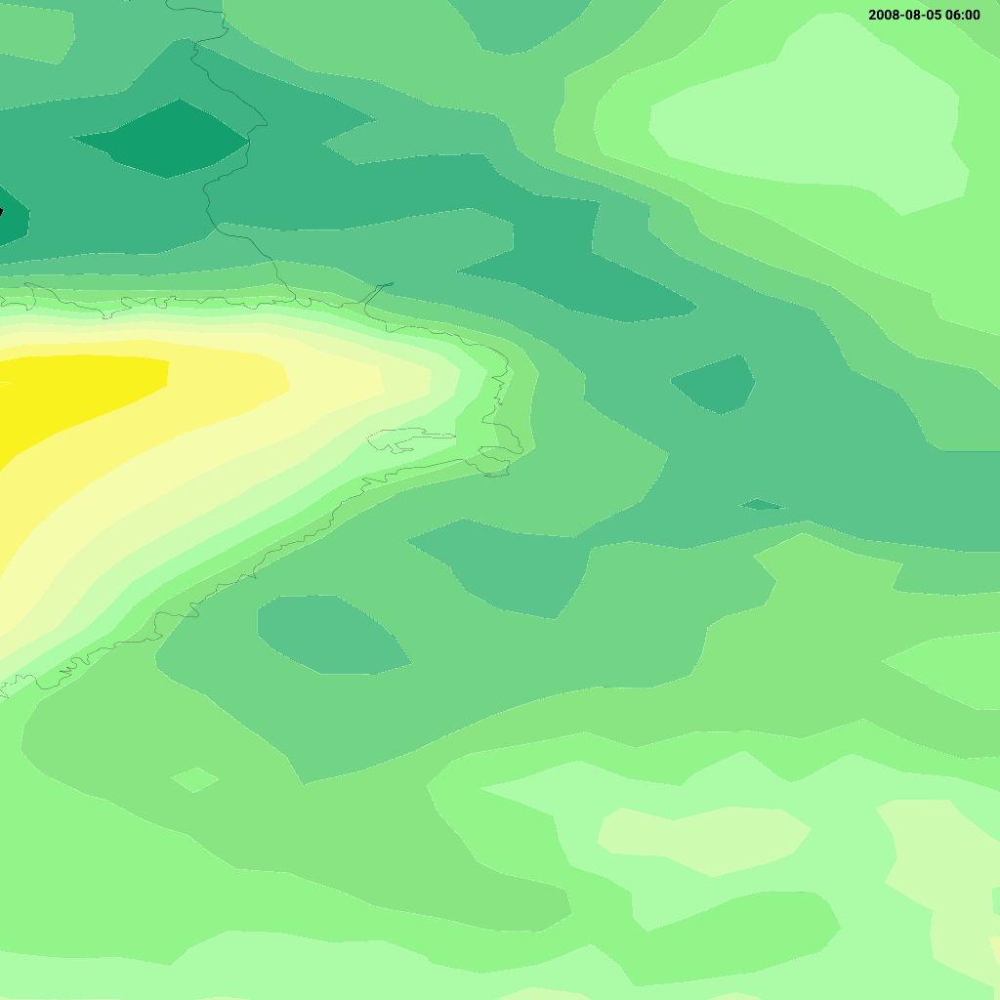
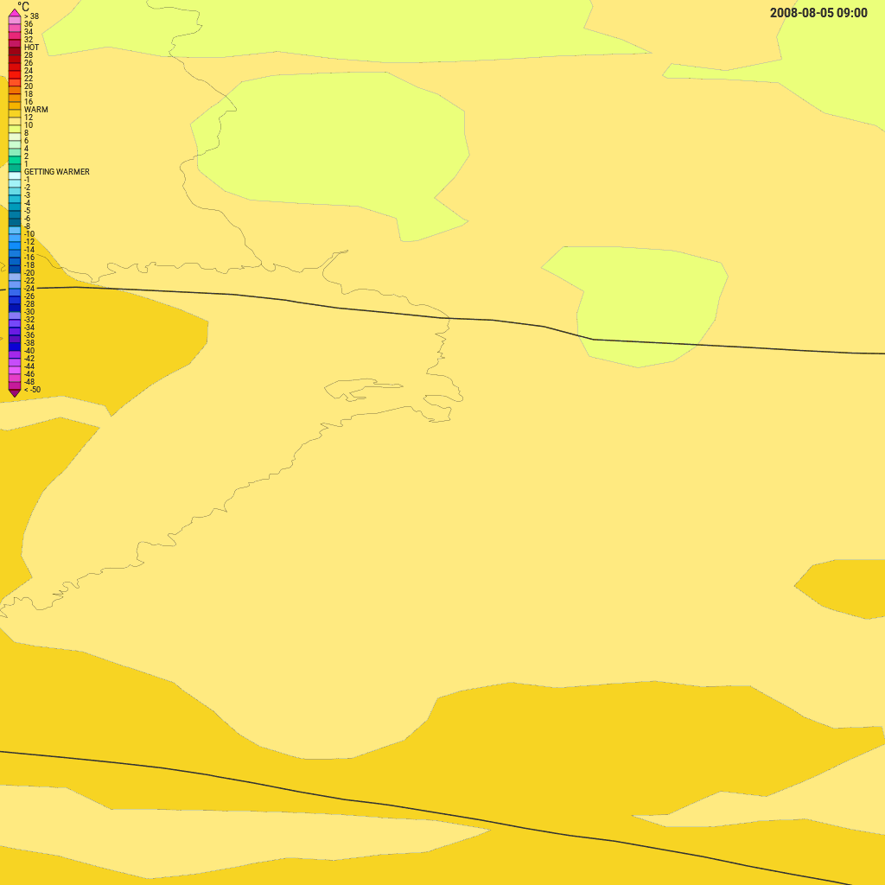
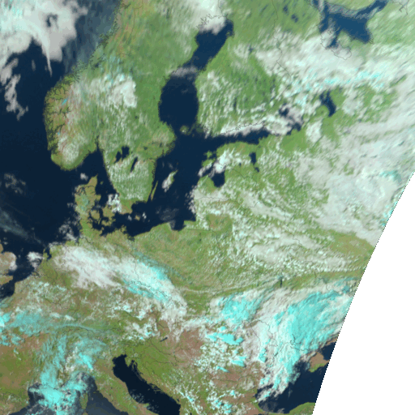

# WMTS Test Examples

The WMTS tests exercise the `/wmts` endpoint, which implements OGC Web Map Tile Service 1.0.0.  The REST-KVP hybrid URL path has the form:

```
/wmts/1.0.0/{layer}/{style}[/{dimension}…]/{TileMatrixSet}/{TileMatrix}/{TileRow}/{TileCol}.{format}
```

Temporal and vertical layers carry their dimension values as **extra path segments between the style and the TileMatrixSet** (see [Dimensions](#dimensions) below).  Layers without dimensions use the plain seven-segment form `…/{style}/{TileMatrixSet}/…`.

Test inputs are in [`test/input/wmts_*.get`](../../test/input/) and expected outputs in [`test/output/wmts_*.get`](../../test/output/).

## Contents

- [URL Structure](#url-structure)
  - [Dimensions](#dimensions)
- [GetCapabilities and API](#getcapabilities-and-api)
  - [Capabilities Document](#capabilities-document)
    - <sub>[wmts_getcapabilities](#wmts_getcapabilities)</sub>
  - [OpenAPI Definition](#openapi-definition)
    - <sub>[wmts_api](#wmts_api) · [wmts_api_docs](#wmts_api_docs)</sub>
- [GetTile](#gettile)
  - [Output Formats](#output-formats)
    - <sub>[wmts_gettile_isoband](#wmts_gettile_isoband) · [wmts_gettile_temperature_numbers](#wmts_gettile_temperature_numbers) · [wmts_gettile_geotiff](#wmts_gettile_geotiff) · [wmts_gettile_datatile_wind](#wmts_gettile_datatile_wind)</sub>
  - [Time Dimension](#time-dimension)
    - <sub>[wmts_gettile_time_in_path](#wmts_gettile_time_in_path) · [wmts_gettile_timeonly_path](#wmts_gettile_timeonly_path) · [wmts_gettile_time_reftime_path](#wmts_gettile_time_reftime_path) · [wmts_gettile_time_current](#wmts_gettile_time_current)</sub>
  - [Elevation Dimension](#elevation-dimension)
    - <sub>[wmts_gettile_elevation_850 / _500](#wmts_gettile_elevation_850--_500)</sub>
  - [Product Variants](#product-variants)
    - <sub>[wmts_gettile_variant_ground](#wmts_gettile_variant_ground) · [wmts_gettile_variant_hires](#wmts_gettile_variant_hires)</sub>
  - [Satellite Images](#satellite-images)
    - <sub>[wmts_satellite_gettile](#wmts_satellite_gettile)</sub>
  - [Resource Resolution](#resource-resolution)
    - <sub>[wmts_gettile_wms_root_css](#wmts_gettile_wms_root_css)</sub>
- [GetFeatureInfo](#getfeatureinfo)
  - [Response Formats](#response-formats)
    - <sub>[wmts_getfeatureinfo_json](#wmts_getfeatureinfo_json) · [wmts_getfeatureinfo_html](#wmts_getfeatureinfo_html)</sub>
  - [Errors](#errors)
    - <sub>[wmts_getfeatureinfo_ij_out_of_range](#wmts_getfeatureinfo_ij_out_of_range)</sub>

---

## URL Structure

### Dimensions

A layer's dimensions are advertised in `GetCapabilities`: each `<Layer>` lists a `<Dimension>` (with `<ows:Identifier>`, `<ows:UOM>`/`<UnitSymbol>`, `<Default>`, `<Value>`) for every axis it offers, and its `<ResourceURL>` template names the matching placeholders, e.g.:

```
…/{Style}/{Time}/{Reference_time}/{Elevation}/{TileMatrixSet}/{TileMatrix}/{TileRow}/{TileCol}.png
```

At request time each placeholder becomes a **path segment**, in the same order the capabilities advertise them:

| Dimension | Identifier | Example value | Maps to |
|-----------|------------|---------------|---------|
| Time | `Time` | `20080909T1200` | valid time |
| Reference time | `Reference_time` | `20080909T0000` | model analysis / origin time |
| Elevation | `Elevation` | `850` | vertical level (e.g. pressure in hPa) |

So a temperature layer on pressure levels is requested as:

```
/wmts/1.0.0/test:t2m_pressure/default/20080909T1200/20080909T0000/850/EPSG:3067/3/2/4.png
```

Notes:

- Identifiers are capitalised (`Time`, `Reference_time`, `Elevation`) to match what the GeoWeb OpenLayers client substitutes into the template.
- Any omitted trailing dimension falls back to its default (e.g. the most current time); a bare seven-segment URL renders the layer at all defaults.
- A `TIME=` query parameter is still accepted for backward compatibility, but the path segment takes precedence.

---

## GetCapabilities and API

### Capabilities Document

#### wmts_getcapabilities

**Input:** [`test/input/wmts_getcapabilities.get`](../../test/input/wmts_getcapabilities.get)

```
GET /wmts/1.0.0/WMTSCapabilities.xml HTTP/1.0
```

Returns the WMTS 1.0.0 capabilities document listing all available tile layers, tile matrix sets, styles, and supported output formats.  Each layer advertises tile matrix sets for EPSG:3035, EPSG:3067, EPSG:3857, and EPSG:4326.

**Output:** [`test/output/wmts_getcapabilities.get`](../../test/output/wmts_getcapabilities.get) — XML

### OpenAPI Definition

#### wmts_api

**Input:** [`test/input/wmts_api.get`](../../test/input/wmts_api.get)

```
GET /wmts/api HTTP/1.0
```

Returns the generated OpenAPI 3.1 definition of the RESTful WMTS interface: the capabilities document and the GetTile and GetFeatureInfo paths for zero to three dimension segments, with the layers, styles and formats of the configuration as enumerations.

**Output:** [`test/output/wmts_api.get`](../../test/output/wmts_api.get) — JSON

#### wmts_api_docs

**Input:** [`test/input/wmts_api_docs.get`](../../test/input/wmts_api_docs.get)

```
GET /wmts/api/docs HTTP/1.0
```

Returns the Swagger UI page that renders the definition above.

**Output:** [`test/output/wmts_api_docs.get`](../../test/output/wmts_api_docs.get) — HTML

---

## GetTile

### Output Formats

#### wmts_gettile_isoband

**Input:** [`test/input/wmts_gettile_isoband.get`](../../test/input/wmts_gettile_isoband.get)

```
GET /wmts/1.0.0/test:t2m/temperature_one_degrees/EPSG:4326/5/4/36.png?TIME=20080805T030000 HTTP/1.0
```

| Path segment | Value | Description |
|--------------|-------|-------------|
| `test:t2m` | Layer | Temperature isoband layer in customer `test` |
| `temperature_one_degrees` | Style | 1°C isoband interval style |
| `EPSG:4326` | TileMatrixSet | WGS 84 tile grid |
| `5` | TileMatrix | Zoom level 5 |
| `4` | TileRow | Row 4 within the tile grid |
| `36` | TileCol | Column 36 within the tile grid |
| `.png` | Format | PNG output |
| `TIME` | `20080805T030000` | Valid time query parameter |

Returns a 1024×1024 PNG tile of temperature isobands.

**Output:** [`test/output/wmts_gettile_isoband.get`](../../test/output/wmts_gettile_isoband.get) — PNG (1024×1024)



#### wmts_gettile_temperature_numbers

**Input:** [`test/input/wmts_gettile_temperature_numbers.get`](../../test/input/wmts_gettile_temperature_numbers.get)

```
GET /wmts/1.0.0/test:opendata_temperature_numbers/default/EPSG:4326/5/4/36.svg?TIME=20130805T1500 HTTP/1.0
```

| Path segment | Value | Description |
|--------------|-------|-------------|
| `test:opendata_temperature_numbers` | Layer | Temperature observation numbers |
| `default` | Style | Default style |
| `.svg` | Format | SVG output (vector tiles) |
| `TIME` | `20130805T1500` | Valid time |

Returns a 1024×1024 SVG tile containing temperature number annotations as vector graphics.

**Output:** [`test/output/wmts_gettile_temperature_numbers.get`](../../test/output/wmts_gettile_temperature_numbers.get) — SVG


#### wmts_gettile_geotiff

**Input:** [`test/input/wmts_gettile_geotiff.get`](../../test/input/wmts_gettile_geotiff.get)

```
GET /wmts/1.0.0/grid:raster_1/default/EPSG:4326/5/4/36.tiff?TIME=20080805T080000 HTTP/1.0
```

| Path segment | Value | Description |
|--------------|-------|-------------|
| `grid:raster_1` | Layer | Raw gridded raster data layer |
| `.tiff` | Format | GeoTIFF raster tile |
| `TIME` | `20080805T080000` | Valid time |

Returns a GeoTIFF tile containing raw numerical grid data (not rendered colour).  Used for programmatic access to model data in raster form.

**Output:** [`test/output/wmts_gettile_geotiff.get`](../../test/output/wmts_gettile_geotiff.get) — GeoTIFF (metadata/header only in the test)

#### wmts_gettile_datatile_wind

**Input:** [`test/input/wmts_gettile_datatile_wind.get`](../../test/input/wmts_gettile_datatile_wind.get)

```
GET /wmts/1.0.0/grid:wind_speed_and_direction_1/default/EPSG:4326/5/4/36.datatile?TIME=20080805T080000 HTTP/1.0
```

| Path segment | Value | Description |
|--------------|-------|-------------|
| `grid:wind_speed_and_direction_1` | Layer | Grid engine wind arrow layer (direction + speed) |
| `.datatile` | Format | DataTile: data values encoded in an RGBA PNG |
| `TIME` | `20080805T080000` | Valid time |

Returns a dual-band DataTile for client-side rendering such as wind particle animations.  Direction is stored in band 1 and speed in band 2, and the `datatile:components` tag (`dirspeed`) tells clients this from a U/V pair.

**Output:** [`test/output/wmts_gettile_datatile_wind.get`](../../test/output/wmts_gettile_datatile_wind.get) — PNG (1024×1024 RGBA DataTile)

### Time Dimension

#### wmts_gettile_time_in_path

**Input:** [`test/input/wmts_gettile_time_in_path.get`](../../test/input/wmts_gettile_time_in_path.get)

```
GET /wmts/1.0.0/test:opendata_temperature_numbers/default/20130805T1500/EPSG:4326/5/4/36.svg HTTP/1.0
```

The valid time given as a `{Time}` path segment instead of the `TIME` query parameter.  The tile is identical to [`wmts_gettile_temperature_numbers`](#wmts_gettile_temperature_numbers), which requests the same time with `TIME=`.

**Output:** [`test/output/wmts_gettile_time_in_path.get`](../../test/output/wmts_gettile_time_in_path.get) — SVG

#### wmts_gettile_timeonly_path

**Input:** [`test/input/wmts_gettile_timeonly_path.get`](../../test/input/wmts_gettile_timeonly_path.get)

```
GET /wmts/1.0.0/test:t2m_p/default/20080805T0600/EPSG:4326/5/4/36.png HTTP/1.0
```

`test:t2m_p` advertises both `Time` and `Reference_time`.  Only the time segment is given here, so the reference time falls back to its default.

**Output:** [`test/output/wmts_gettile_timeonly_path.get`](../../test/output/wmts_gettile_timeonly_path.get) — PNG (1024×1024)



#### wmts_gettile_time_reftime_path

**Input:** [`test/input/wmts_gettile_time_reftime_path.get`](../../test/input/wmts_gettile_time_reftime_path.get)

```
GET /wmts/1.0.0/test:t2m_p/default/20080805T0600/20080805T0631/EPSG:4326/5/4/36.png HTTP/1.0
```

The same tile with both dimensions in the path: `{Time}` 06:00 and `{Reference_time}` 06:31, the only model run the test data advertises.  The output is identical to the time-only request above.

**Output:** [`test/output/wmts_gettile_time_reftime_path.get`](../../test/output/wmts_gettile_time_reftime_path.get) — PNG (1024×1024)

#### wmts_gettile_time_current

**Input:** [`test/input/wmts_gettile_time_current.get`](../../test/input/wmts_gettile_time_current.get)

```
GET /wmts/1.0.0/test:t2m/temperature_one_degrees/EPSG:4326/5/4/36.png?TIME=current HTTP/1.0
```

`TIME=current` resolves to the layer's default time, the same time `<Default>` shows in the capabilities, instead of the wall clock.  The test data is from 2008, so the default is the first timestep, and the tile is identical to [`wmts_gettile_isoband`](#wmts_gettile_isoband).

**Output:** [`test/output/wmts_gettile_time_current.get`](../../test/output/wmts_gettile_time_current.get) — PNG (1024×1024)

### Elevation Dimension

#### wmts_gettile_elevation_850 / _500

**Input:** [`test/input/wmts_gettile_elevation_850.get`](../../test/input/wmts_gettile_elevation_850.get) / [`_500`](../../test/input/wmts_gettile_elevation_500.get)

```
GET /wmts/1.0.0/test:t2m_pressure/default/20080909T1200/20080909T0000/850/EPSG:3067/3/2/4.png HTTP/1.0
GET /wmts/1.0.0/test:t2m_pressure/default/20080909T1200/20080909T0000/500/EPSG:3067/3/2/4.png HTTP/1.0
```

| Path segment | Value | Description |
|--------------|-------|-------------|
| `test:t2m_pressure` | Layer | Temperature isobands on constant pressure levels |
| `default` | Style | Default style |
| `20080909T1200` | `{Time}` | Valid time |
| `20080909T0000` | `{Reference_time}` | Model analysis time |
| `850` / `500` | `{Elevation}` | Pressure level in hPa |
| `EPSG:3067` | TileMatrixSet | TM35FIN tile grid |
| `3/2/4` | TileMatrix/Row/Col | Zoom 3, row 2, col 4 |

The two requests differ only in the `{Elevation}` segment; they render **distinct** tiles (850 hPa vs 500 hPa temperature fields), which guards against the elevation dimension being silently dropped on the way to the renderer.

**Output:** [`test/output/wmts_gettile_elevation_850.get`](../../test/output/wmts_gettile_elevation_850.get) / `_500` — PNG

| 850 hPa | 500 hPa |
|---------|---------|
|  |  |

### Product Variants

A product file can advertise several layers through its `variants` array, and the layer name selects the variant whose settings are substituted into the product.  WMTS applies variants the same way as WMS GetMap.

#### wmts_gettile_variant_ground

**Input:** [`test/input/wmts_gettile_variant_ground.get`](../../test/input/wmts_gettile_variant_ground.get)

```
GET /wmts/1.0.0/variant:ground:groundtemperature/default/20160414T0000/EPSG:4326/5/4/36.png HTTP/1.0
```

The `ground` variant selects the ground temperature parameter.  The OGC API Tiles test `tiles_gettile_variant_ground` renders a byte-identical tile.

**Output:** [`test/output/wmts_gettile_variant_ground.get`](../../test/output/wmts_gettile_variant_ground.get) — PNG (1024×1024)


#### wmts_gettile_variant_hires

**Input:** [`test/input/wmts_gettile_variant_hires.get`](../../test/input/wmts_gettile_variant_hires.get)

```
GET /wmts/1.0.0/variant:pal:hirestemperature/default/20080805T1200/EPSG:4326/5/4/36.png HTTP/1.0
```

The `hirestemperature` variant overrides the isoband definitions (`l1.isobands`, a `json:` include) and the CSS of the product, so it tests that a variant can select includes.

**Output:** [`test/output/wmts_gettile_variant_hires.get`](../../test/output/wmts_gettile_variant_hires.get) — PNG (1024×1024)


### Satellite Images

#### wmts_satellite_gettile

**Input:** [`test/input/wmts_satellite_gettile.get`](../../test/input/wmts_satellite_gettile.get)

```
GET /wmts/1.0.0/test:satellite_meteosat/default/20260826T1415/EPSG:3857/3/2/4.png HTTP/1.0
```

A Web Mercator tile of the `test:satellite_meteosat` layer: the SEVIRI natural colour composite of the satellite engine with country borders on top.  The composite is an RGBA image in EPSG:3035 from the smartmet-test-data package, reprojected to the tile; the area the satellite does not see is transparent.

**Output:** [`test/output/wmts_satellite_gettile.get`](../../test/output/wmts_satellite_gettile.get) — PNG (1024×1024, shown here at 512×512)



### Resource Resolution

#### wmts_gettile_wms_root_css

**Input:** [`test/input/wmts_gettile_wms_root_css.get`](../../test/input/wmts_gettile_wms_root_css.get)

```
GET /wmts/1.0.0/ely:elymap/default/20080805T0600/20080805T0631/EPSG:4326/5/4/36.png HTTP/1.0
```

`ely:elymap` is a WMS-only product whose CSS file `maps/wmsroot.css` exists only under the WMS root.  A request with dimension segments must still resolve CSS, markers and patterns from the WMS root and not from the Dali root.

**Output:** [`test/output/wmts_gettile_wms_root_css.get`](../../test/output/wmts_gettile_wms_root_css.get) — PNG (1024×1024)


---

## GetFeatureInfo

The RESTful FeatureInfo resource is the GetTile path followed by the pixel row and column within the tile: `…/{TileMatrixSet}/{TileMatrix}/{TileRow}/{TileCol}/{J}/{I}.{format}`.  The request is translated into a WMS GetFeatureInfo request and answered by the WMS implementation.

### Response Formats

#### wmts_getfeatureinfo_json

**Input:** [`test/input/wmts_getfeatureinfo_json.get`](../../test/input/wmts_getfeatureinfo_json.get)

```
GET /wmts/1.0.0/test:t2m_p/default/20080805T0600/EPSG:4326/5/4/36/512/512.json HTTP/1.0
```

Returns the temperature at the centre pixel of the tile, with the time, coordinates and nearest place name.  The returned coordinates (25.3125°E, 64.6875°N) verify the tile and pixel translation.

**Output:** [`test/output/wmts_getfeatureinfo_json.get`](../../test/output/wmts_getfeatureinfo_json.get) — JSON

#### wmts_getfeatureinfo_html

**Input:** [`test/input/wmts_getfeatureinfo_html.get`](../../test/input/wmts_getfeatureinfo_html.get)

```
GET /wmts/1.0.0/test:t2m_p/default/20080805T0600/EPSG:4326/5/4/36/512/512.html HTTP/1.0
```

The same query as an HTML table.

**Output:** [`test/output/wmts_getfeatureinfo_html.get`](../../test/output/wmts_getfeatureinfo_html.get) — HTML

### Errors

#### wmts_getfeatureinfo_ij_out_of_range

**Input:** [`test/input/wmts_getfeatureinfo_ij_out_of_range.get`](../../test/input/wmts_getfeatureinfo_ij_out_of_range.get)

```
GET /wmts/1.0.0/test:t2m_p/default/20080805T0600/EPSG:4326/5/4/36/512/4096.json HTTP/1.0
```

A pixel column outside the 1024×1024 tile returns an OWS exception report with the standard WMTS code `PointIJOutOfRange`.

**Output:** [`test/output/wmts_getfeatureinfo_ij_out_of_range.get`](../../test/output/wmts_getfeatureinfo_ij_out_of_range.get) — XML

---
